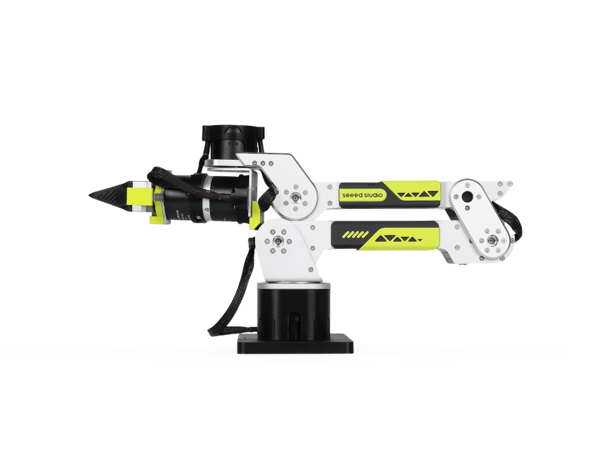

# Rebot-Joycon

[English](README.md) | [简体中文](README_zh.md) · [MIT License](LICENSE)

A codebase for controlling robots with Joy-Cons to collect data for embodied AI.

Supports keyboard and right Joy-Con control of the **reBot B601-DM**, in MuJoCo and on hardware. For data collection, ACT training, and inference, see [Learning_Model](Learning_Model/README.md).

This update adds automatic gripper motor detection, slower homing, and calibration that saves zero positions to motor Flash.

## Installation

Requires Linux, Python 3.12, a graphical desktop, OpenGL, and X11/Xorg keyboard input. Run commands from the repository root:

```bash
python3.12 -m venv .venv
.venv/bin/python -m pip install -r requirements.txt
```

Examples and Learning_Model share this root `.venv`, using LeRobot's NumPy 2.x range. Skip environment creation if it already exists; add learning dependencies using the [Learning_Model installation](Learning_Model/README.md#installation).

**Keyboard control does not require joycon-robotics.** Only for Joy-Con control (examples 3/6), download and install the optional dependency:

```bash
git clone https://github.com/box2ai-robotics/joycon-robotics.git joycon-robotics
.venv/bin/python -m pip install -e ./joycon-robotics
```

Skip cloning if the directory already exists. For drivers, Bluetooth pairing, and troubleshooting, follow [joycon-robotics/README.md](joycon-robotics/README.md) ([online copy](https://github.com/box2ai-robotics/joycon-robotics/blob/master/README.md)). Use the same `.venv` for its Python installation.

<a id="零位校准与使用"></a>

## Calibration

Place the arm at the mechanical zero pose shown below with the gripper fully closed; calibration writes all seven motor zero positions to Flash so they persist after power-off.



```bash
.venv/bin/python examples/0_calibrate_rebot.py --port /dev/ttyACM0
```

## Run

Run these commands from the repository root, choosing one example at a time. Examples 1–3 run in simulation; 4–6 control real hardware. All examples open a MuJoCo window. In keyboard modes, hold a key to update the target, release it to stop updating, and press `0` to return home.

### Simulation examples

#### 1. Keyboard joint control (qpos)

Adjust individual joint angles to check each joint's direction and gripper movement.

```bash
.venv/bin/python examples/1_ReBot_B601_DM_Key_qpos_SIM.py
```

| Control | Increase angle / close | Decrease angle / open |
| --- | --- | --- |
| Joints 1–6 (in order) | `1`, `2`, `3`, `4`, `5`, `6` | `q`, `w`, `e`, `r`, `t`, `y` |
| Gripper | `7` closes | `u` opens |

#### 2. Keyboard end-effector control (gpos / IK)

Adjust the end-effector position and orientation; inverse kinematics (IK) computes the joint angles. Use this to test translation, rotation, and gripper coordination.

```bash
.venv/bin/python examples/2_ReBot_B601_DM_Key_Gpos_SIM.py
```

| Control | Positive / close | Negative / open |
| --- | --- | --- |
| X translation | `w` | `s` |
| Y translation | `a` | `d` |
| Z translation | `r` | `f` |
| Roll | `e` | `q` |
| Pitch | `g` | `t` |
| Yaw | `z` | `c` |
| Gripper | `1` closes | `3` opens |

#### 3. Right Joy-Con end-effector control

Use the right Joy-Con to provide end-effector position and orientation targets, which IK converts into simulated arm motion. Install `joycon-robotics` and complete Bluetooth pairing following the [installation instructions](#installation).

```bash
.venv/bin/python examples/3_ReBot_B601_DM_Joycon_Gpos_SIM.py
```

Press `ZR` to toggle the gripper with one-second full-travel target interpolation. See the [joycon-robotics usage guide](https://github.com/box2ai-robotics/joycon-robotics/blob/master/README.md) for controller operation.

### Real hardware examples

Before running, complete hardware zeroing and power-cycle verification in [Calibration](#calibration). **After motor range and feedback checks, examples 4–6 enable the arm and send a home target (TCP Z = 0.25 m, gripper closed).** They select the sole `/dev/ttyACM*` or `/dev/ttyUSB*` device. With multiple devices, set `REBOT_PORT=/dev/ttyACM0`. Serial access is required.

#### 4. Keyboard joint control (qpos)

Control real joint angles with a MuJoCo display. Keys match [example 1](#1-keyboard-joint-control-qpos): `1…6` increase joint angles, `q/w/e/r/t/y` decrease them, `7/u` close/open the gripper, and `0` returns home.

```bash
.venv/bin/python examples/4_ReBot_B601_DM_Key_qpos_REAL.py
```

#### 5. Keyboard end-effector control (gpos / IK)

Use IK to translate and rotate the real end effector with a MuJoCo display. Keys match [example 2](#2-keyboard-end-effector-control-gpos--ik): `w/s`, `a/d`, `r/f` control X/Y/Z; `e/q`, `g/t`, `z/c` control roll/pitch/yaw; `1/3` close/open the gripper; `0` returns home.

```bash
.venv/bin/python examples/5_ReBot_B601_DM_Key_Gpos_REAL.py
```

#### 6. Right Joy-Con end-effector control

Use a paired right Joy-Con to control the real end-effector position and orientation with a MuJoCo display. As in [example 3](#3-right-joy-con-end-effector-control), `joycon-robotics` is required; `ZR` toggles the gripper, with the original one-second interpolation for 4310 and SDK interpolation at 2 rad/s for 4340; the preview shows the targets actually sent.

```bash
.venv/bin/python examples/6_ReBot_B601_DM_Joycon_Gpos_REAL.py
```

Closing the window normally returns the real arm home before disabling it. `Ctrl+C` or an exception disables it without an additional return-home motion.

## Directory guide

| Path | Purpose |
| --- | --- |
| `examples/` | Examples 0–6, shared SDK, kinematics, motor communication, and protection. |
| `URDF/` | Robot models, meshes, and validation records. |
| `joycon-robotics/` | Optional external Joy-Con dependency; ignored by Git. |
| `Learning_Model/` | Adapted LeRobot, data collection, ACT training, and inference. |
| `gravity_compensation/` | Gravity compensation demo; needs external reBot packages and Pinocchio. |
| `docs/` | [Project map](docs/CODEX_PROJECT_MAP.md), [validation history](docs/RUNBOOK.md), and reference images. |
| `logs/` | Automatic runtime logs; kept locally and ignored by Git. |

<a id="自动运行日志"></a>

## Logs and protection

Examples 0–6 and SDK hardware connections retain console and event logs in `logs/`. Real-arm gripper protection retracts the target and latches the blocked direction when absolute feedback torque exceeds 1 N·m; reverse movement is allowed. This is not a hard motor torque limit. Simulation has no motor torque feedback.

Third-party code and models retain their own licenses. `Learning_Model/lerobot` is included as ordinary source files with local reBot/Joy-Con adaptations, based on [LeRobot commit 53feaef](https://github.com/huggingface/lerobot/commit/53feaef37b67e8f4c23b6953e880ff535e39d6fe). An unmodified upstream clone is not a replacement.
