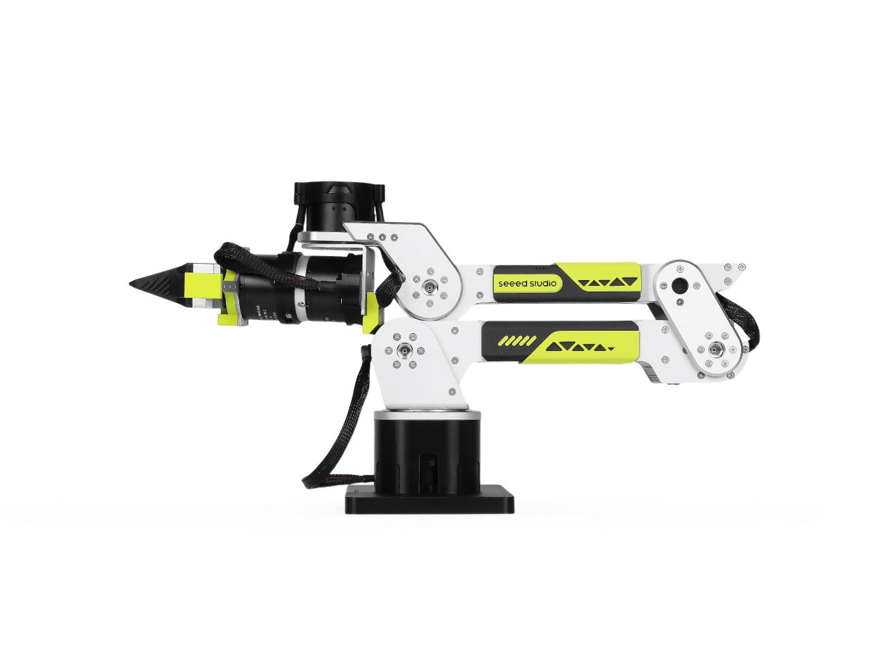

# Rebot-Joycon

[English](README.md) | [简体中文](README_zh.md) · [MIT 协议](LICENSE)

使用 Joy-Con 控制机器人，为具身智能采集数据的代码库。

支持 **reBot B601-DM** 的键盘及右 Joy-Con 控制，可运行 MuJoCo 仿真或连接真机。数据采集、ACT 训练与推理见 [Learning_Model](Learning_Model/README_zh.md)。

## 安装

需要 Linux、Python 3.12、图形桌面、OpenGL 和 X11/Xorg 键盘监听环境。在仓库根目录执行：

```bash
python3.12 -m venv .venv
.venv/bin/python -m pip install -r requirements.txt
```

examples 与 Learning_Model 共用根目录 `.venv`，NumPy 按 LeRobot 的 2.x 范围统一。已有环境时跳过创建；需要学习功能时，按 [Learning_Model 安装说明](Learning_Model/README_zh.md#安装)追加依赖。

**键盘控制不需要下载 joycon-robotics。** 仅使用 Joy-Con（3/6 号示例）时，额外下载并安装：

```bash
git clone https://github.com/box2ai-robotics/joycon-robotics.git joycon-robotics
.venv/bin/python -m pip install -e ./joycon-robotics
```

已有目录时跳过克隆。驱动安装、蓝牙配对和常见问题直接参阅 [joycon-robotics/README.md](joycon-robotics/README.md)（[中文版](joycon-robotics/README_zh.md) / [在线说明](https://github.com/box2ai-robotics/joycon-robotics/blob/master/README_zh.md)）；其中 Python 包安装使用同一个 `.venv` 环境。

## 零位校准与使用

需要重新校准时，将机械臂摆到机械零位、夹爪完全闭合：



```bash
.venv/bin/python examples/0_calibrate_rebot.py --port /dev/ttyACM0
```

脚本只读取反馈，不使能、不发运动指令。[examples/calibration](examples/calibration) 下的 `rebot.json` 和 `rebot.encoders.json` 须一起保留，与 LeRobot 共用，校准值须适用于你的机械臂。

## 运行

以下命令均在仓库根目录执行，每次选择一个示例。1–3 号为仿真，4–6 号控制真机；全部示例打开 MuJoCo 窗口。键盘模式按住按键更新目标，松开停止更新，`0` 回中。

### 仿真示例

#### 1. 键盘关节控制（qpos）

直接调整各关节角度，适合逐轴检查运动方向和夹爪开合。

```bash
.venv/bin/python examples/1_ReBot_B601_DM_Key_qpos_SIM.py
```

| 控制对象 | 增加角度 / 闭爪 | 减少角度 / 开爪 |
| --- | --- | --- |
| 关节 1–6（按顺序对应） | `1`、`2`、`3`、`4`、`5`、`6` | `q`、`w`、`e`、`r`、`t`、`y` |
| 夹爪 | `7` 闭爪 | `u` 开爪 |

#### 2. 键盘末端位姿控制（gpos / IK）

调整末端位置与姿态，由逆运动学（IK）计算关节角度，适合测试平移、旋转和夹爪配合。

```bash
.venv/bin/python examples/2_ReBot_B601_DM_Key_Gpos_SIM.py
```

| 控制对象 | 正向 / 闭爪 | 负向 / 开爪 |
| --- | --- | --- |
| X 平移 | `w` | `s` |
| Y 平移 | `a` | `d` |
| Z 平移 | `r` | `f` |
| Roll 旋转 | `e` | `q` |
| Pitch 旋转 | `g` | `t` |
| Yaw 旋转 | `z` | `c` |
| 夹爪 | `1` 闭爪 | `3` 开爪 |

#### 3. 右 Joy-Con 末端位姿控制

使用右 Joy-Con 提供末端位置与姿态，经 IK 驱动仿真机械臂。先按[安装说明](#安装)安装 `joycon-robotics` 并完成蓝牙配对。

```bash
.venv/bin/python examples/3_ReBot_B601_DM_Joycon_Gpos_SIM.py
```

按 `ZR` 切换夹爪开合，目标按一秒全行程插补。手柄操作详见 [joycon-robotics 使用说明](https://github.com/box2ai-robotics/joycon-robotics/blob/master/README_zh.md)。

### 真机示例

运行前确认[零位校准与使用](#零位校准与使用)中的校准文件适用于当前机械臂。**4–6 号启动即使能并发送回中目标（TCP Z=0.25 m、夹爪闭合）。** 串口按序列号 `0000000` 自动匹配 `/dev/ttyACM0` 或 `/dev/ttyACM1`，需有串口权限。

#### 4. 键盘关节控制（qpos）

直接控制真机各关节角度，并在 MuJoCo 中显示。按键与 [1 号仿真](#1-键盘关节控制qpos)一致：`1…6` 增加关节角度，`q/w/e/r/t/y` 减少，`7/u` 闭爪/开爪，`0` 回中。

```bash
.venv/bin/python examples/4_ReBot_B601_DM_Key_qpos_REAL.py
```

#### 5. 键盘末端位姿控制（gpos / IK）

通过 IK 控制真机末端平移与旋转，并在 MuJoCo 中显示。按键与 [2 号仿真](#2-键盘末端位姿控制gpos--ik)一致：`w/s`、`a/d`、`r/f` 控制 X/Y/Z，`e/q`、`g/t`、`z/c` 控制 Roll/Pitch/Yaw，`1/3` 闭爪/开爪，`0` 回中。

```bash
.venv/bin/python examples/5_ReBot_B601_DM_Key_Gpos_REAL.py
```

#### 6. 右 Joy-Con 末端位姿控制

使用已配对的右 Joy-Con 控制真机末端位置与姿态，并在 MuJoCo 中显示。与 [3 号仿真](#3-右-joy-con-末端位姿控制)一样，需安装 `joycon-robotics`；`ZR` 切换夹爪开合，目标按一秒全行程插补。

```bash
.venv/bin/python examples/6_ReBot_B601_DM_Joycon_Gpos_REAL.py
```

正常关窗时，真机回中后失能；`Ctrl+C` 或异常直接失能，不额外回中。

## 目录说明

| 路径 | 用途 |
| --- | --- |
| `examples/` | 0–6 号示例、共享 SDK、运动学、电机通信、保护及测试。 |
| `URDF/` | 机械臂模型、网格及验证记录。 |
| `joycon-robotics/` | 可选手柄依赖，Git 忽略上传。 |
| `Learning_Model/` | 适配的 LeRobot、数据采集、ACT 训练与推理。 |
| `gravity_compensation/` | 重力补偿演示，需额外的 reBot 包及 Pinocchio。 |
| `docs/` | [任务地图](docs/CODEX_PROJECT_MAP.md)、[验证历史](docs/RUNBOOK.md)及参考图片。 |
| `logs/` | 自动运行日志，本地保留，Git 忽略上传。 |

## 自动运行日志

示例 0–6 和 SDK 真机连接自动保留终端及事件日志。真机夹爪反馈绝对力矩超过 1 N·m 时收回目标、锁存受阻方向，允许反向卸力；这不是电机总力矩硬限幅。仿真无电机力矩反馈。

离线检查：`.venv/bin/python -m unittest discover -s examples -p 'test_*.py' -q`。

第三方代码与模型保留各自许可证。`Learning_Model/lerobot` 已作为普通源码目录收录，基于 [LeRobot 提交 53feaef](https://github.com/huggingface/lerobot/commit/53feaef37b67e8f4c23b6953e880ff535e39d6fe) 并保留本地 reBot/Joy-Con 适配，不能直接替换成未修改的上游版本。
